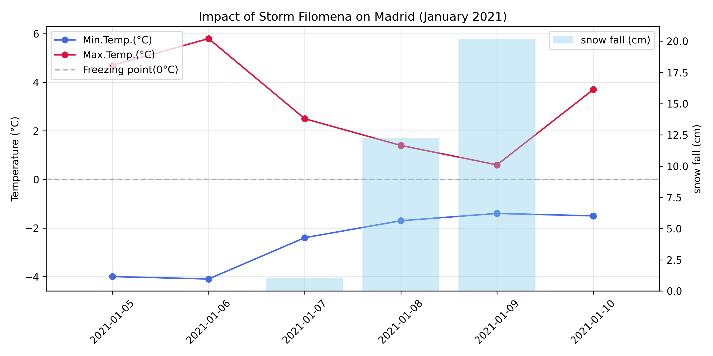
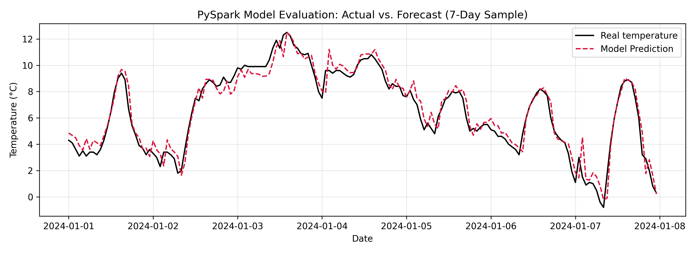

# Madrid Weather Lakehouse & Forecasting Pipeline (PySpark)

[](https://colab.research.google.com/github//jorgefgin/madrid-weather-pyspark/blob/main/notebooks/madrid_weather_pyspark_pipeline.ipynb)


An end-to-end Big Data Engineering and Machine Learning pipeline built with **Apache Spark (PySpark)** following the **Medallion Architecture (Bronze ➔ Silver ➔ Gold)**. The project processes 103,128 hourly meteorological observations from Madrid, Spain (2015–2026), performs automated extreme weather anomaly detection, and trains a distributed ML model for temperature forecasting.

---

## Data Source & Metadata

* **Source:** Historical Meteorological Reanalysis Data from the Madrid station via [Open-Meteo API](https://open-meteo.com/).
* **Location:** Madrid, Spain (`Latitude: 40.3866° N`, `Longitude: -3.6761° W`, `Elevation: 651 m`).
* **Timeframe:** January 1, 2015 – October 6, 2026 (Hourly resolution, `GMT`).
* **Volume:** 103,128 records across 14 variables (2m temperature, apparent temperature, precipitation, rain, snowfall, snow depth, relative humidity, sea-level pressure, WMO weather code, and cloud cover layers).

---

## Project Architecture (Medallion Pattern)


1. **Bronze Layer (Ingestion):** Cleans initial metadata rows from the raw CSV, applies a strict schema (`StructType`) to avoid inference overhead, and converts the dataset to columnar **Apache Parquet** format partitioned by `year`.
2. **Silver Layer (Quality & Feature Engineering):** Normalizes column names to `snake_case`, enforces physical boundary rules (filtering out-of-range humidity and temperature sensor anomalies), extracts calendar attributes (`month`, `day`, `hour`, `day_of_week`, `season`), and creates binary flags for rain and frost. Partitioned by `year` and `month`.
3. **Gold Layer (Analytics & Time-Series):** 
   * Daily aggregated summary table with extreme temperatures ($T_{\min}$, $T_{\max}$, $T_{\text{avg}}$), daily thermal amplitude, and cumulative rainfall/snowfall.
   * Time-series smoothing using **Window Functions** (`Window.orderBy("timestamp").rowsBetween(...)`) to compute 24-hour and 7-day rolling averages.
   * Data-driven anomaly detection without hardcoded dates.

---

## Analytical Insights: Storm Filomena Detection

Through statistical anomaly filtering on snowfall accumulation and sub-zero temperatures, the pipeline automatically isolates the most extreme winter event in the historical series (January 2021):
* **Single-Day Snowfall Record:** **20.16 cm** accumulated on `2021-01-09` (with **12.25 cm** the previous day and a snow depth peak of **0.24 m**).




---

## Extreme Heat Analysis & Gold Layer Persistence
Analysis of the daily temperature records identifies extreme summer heatwaves ($T_{\max} \ge 38.0\text{ °C}$):
* **Frequency of Extreme Heat:** A total of **103 days** reached or exceeded $38.0\text{ °C}$ between 2015 and 2026.
* **All-Time Maximum Temperature:** **41.5 °C** recorded on `2021-08-13` (with a daily thermal amplitude of **20.3 °C**), followed closely by **41.3 °C** on `2022-07-14` and **40.7 °C** on `2025-08-16`.
* **Tropical Nights:** During the top 10 hottest days on record, minimum temperatures ($T_{\min}$) consistently remained above **20.8 °C**, peaking at **24.6 °C** on `2025-06-29`.

#### Top 5 Hottest Days Recorded (Gold Layer Output)
| Date | Min Temp (°C) | Max Temp (°C) | Thermal Range (°C) | Season |
| :--- | :---: | :---: | :---: | :---: |
| **2021-08-13** | 21.2 | **41.5** | 20.3 | Summer |
| **2022-07-14** | 24.5 | **41.3** | 16.8 | Summer |
| **2025-08-16** | 24.2 | **40.7** | 16.5 | Summer |
| **2024-07-24** | 24.2 | **40.4** | 16.2 | Summer |
| **2019-06-28** | 22.4 | **40.3** | 17.9 | Summer |

---


## Predictive Modeling with Spark MLlib

Distributed regression pipeline designed to forecast next-hour temperature ($t$):
* **Feature Engineering (Lag Features):** Autoregressive lag variables built using `F.lag()` ($t-1$, $t-2$, and $t-24$ temperatures, alongside previous-hour relative humidity and atmospheric pressure).
* **Strict Temporal Split:** Chronological split to prevent data leakage:
  * **Training Set (Train):** 2015 – 2023
  * **Testing Set (Test):** 2024 – 2026
* **MLlib Pipeline:** `VectorAssembler` ➔ `StandardScaler` ➔ `LinearRegression`.

### Test Set Evaluation Metrics
| Metric | Value |
| :--- | :--- |
| **MAE (Mean Absolute Error)** | **0.52 °C** |
| **RMSE (Root Mean Squared Error)** | **0.75 °C** |
| **$R^2$ (Coefficient of Determination)** | **0.994** |



---

## Unit Testing (`pytest`)

Core Silver-layer transformations are validated via automated unit tests using `pytest` on synthetic PySpark DataFrames:
* `test_enriquecimiento_estaciones`: Verifies accurate seasonal mapping across all months.
* `test_reglas_calidad_limites`: Confirms quality filters block sensor readings outside realistic physical boundaries.

---

## Repository Structure

```text
madrid-weather-pyspark/
├── docs/
│   └── img/
│       ├── filomena_impact.png
│       └── mllib_predictions.png
├── notebooks/
│   └── madrid_weather_pipeline.ipynb
├── tests/
│   └── test_transforms.py
├── requirements.txt
└── README.md
```

---

## How to Run the Project

1. **Clone the repository:**
   ```bash
   git clone [https://github.com/jorgefgin/madrid-weather-pyspark.git](https://github.com/jorgefgin/madrid-weather-pyspark.git)
   cd madrid-weather-pyspark
   ```
2. **Install dependencies:**
   ```bash
   pip install -r requirements.txt
   ```
3. **Run the unit test suite:**
   ```bash
   pytest tests/test_transforms.py -v
   ```
